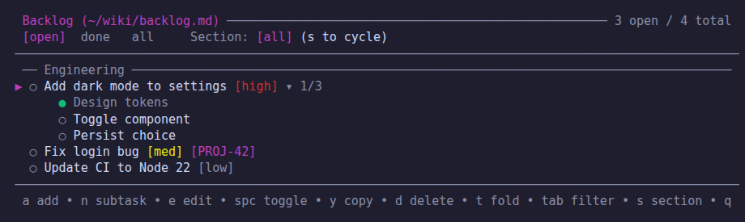

# pi-backlog

Markdown backlog manager. It keeps tasks in one plain Markdown file (default `~/wiki/backlog.md`) and gives you three ways to edit it:

- a **CLI** (`pi-backlog`)
- a **Pi extension** with a `backlog_manage` tool for agents
- an interactive **`/backlog` TUI** inside [Pi](https://github.com/mariozechner/pi-coding-agent)



## Requirements

- Node.js 20+
- Backlog file: `~/wiki/backlog.md` by default. Set `PI_BACKLOG_PATH=/path/to/backlog.md` (CLI, `/backlog` and the agent tool all honour it), or pass `--file <path>` to the CLI. The file and its folder are created on first write.

## Use standalone (CLI only)

```bash
git clone https://github.com/andomm/pi-backlog.git
cd pi-backlog
npm install          # installs deps and builds dist/backlog-cli.mjs
npm link             # optional: puts `pi-backlog` on your PATH
```

Without `npm link`, run `./bin/pi-backlog <command>` or `npm run backlog -- <command>`. The wrapper rebuilds automatically when sources change. No Pi needed.

```bash
pi-backlog add "Write docs" --priority high --subtask "Draft" --subtask "Review"
pi-backlog list --open
pi-backlog subtask-done write-docs 1
pi-backlog done write-docs
```

## Use as a Pi extension

```bash
pi install git:github.com/andomm/pi-backlog
# or from a local clone:
pi install ./pi-backlog
```

Restart Pi (or `/reload`). You get:

- **`/backlog`**: interactive overlay. Keys: `j`/`k` or arrows to move, `space`/`enter` to toggle done, `n` for a new task, `y` to confirm prompts.
- **`backlog_manage` tool**: lets the agent list, add, update, delete tasks and manage subtasks in the same file. Just ask, e.g. "add a backlog task to fix the login bug".

The CLI and the extension edit the same file, so you can mix them.

## CLI

```text
pi-backlog list [--open|--done|--all] [--section <name>] [--json] [--query <text>]
pi-backlog add <title> [--section <name>] [--priority high|med|low] [--ticket <key>] [--detail <text>]... [--subtask <text>]...
pi-backlog done|undone|delete|show <id>
pi-backlog sections
pi-backlog subtask-add <id> <title>
pi-backlog subtask-done|subtask-undone|subtask-delete <id> <subtask>
```

A `<subtask>` is a 1-based number or a title (exact, then unique substring).

## File format

```markdown
## Engineering

- [ ] **Fix login bug** <!-- id: fix-login-bug --> [priority: med] [ticket: PROJ-42]
  - [x] Reproduce
  - [ ] Patch expiry check [blocked-by: 1]
  - Token expiry check is off by one
```

- `##` headings are sections.
- Each task is a checkbox line with a stable `id` comment, optional `[priority: …]`, `[ticket: …]` and `[created: …]` tags.
- Indented checkboxes are subtasks; they can name blockers with `[blocked-by: N, M]`.
- Indented plain bullets are detail lines.

## Development

```bash
npm run backlog -- list   # run the CLI from source (tsx)
npm test                  # unit tests
npm run build             # bundle with esbuild
```

## License

MIT, see [LICENSE](LICENSE).
